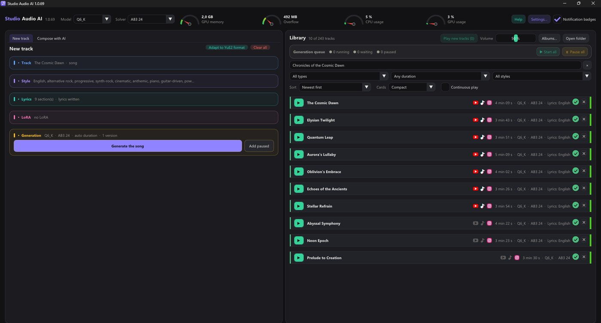
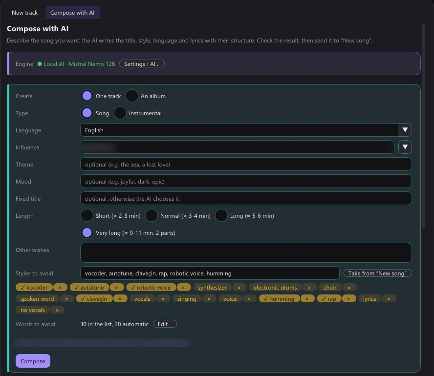
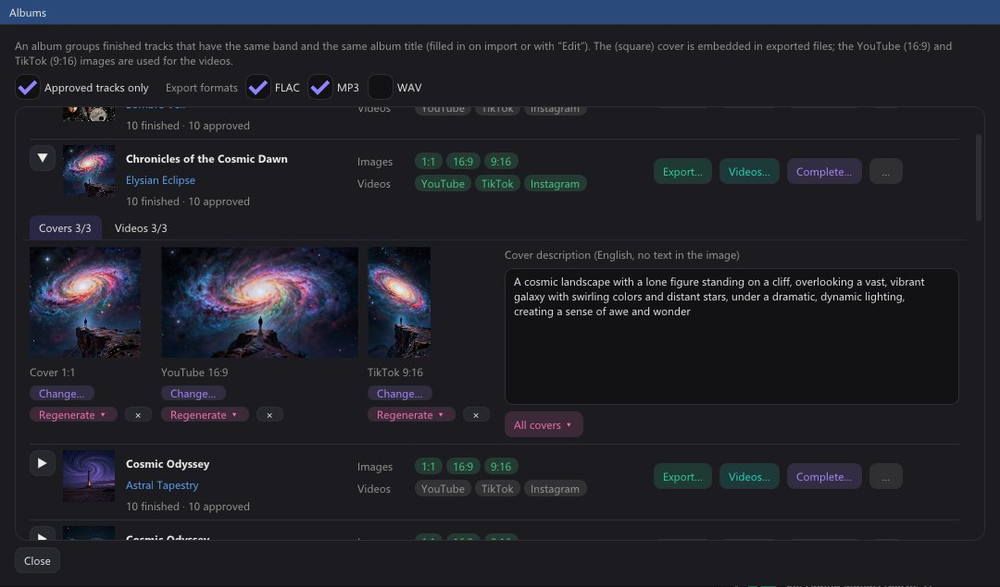
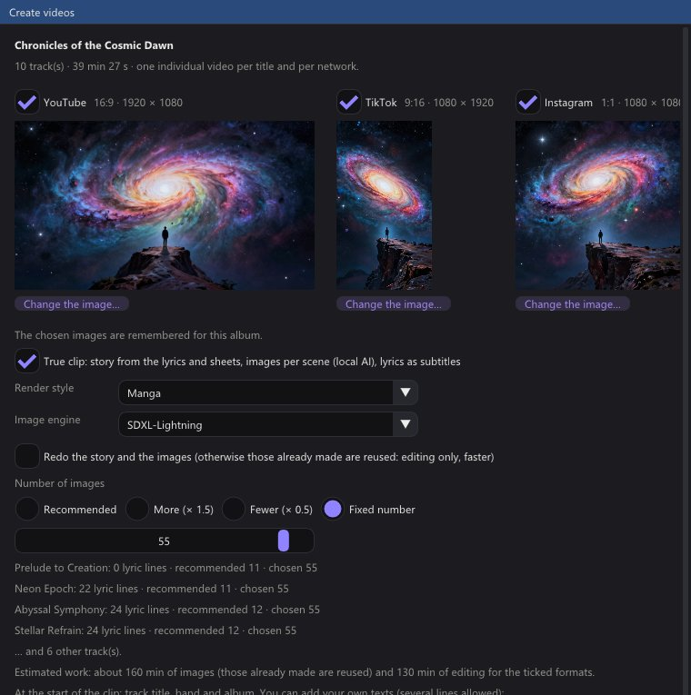
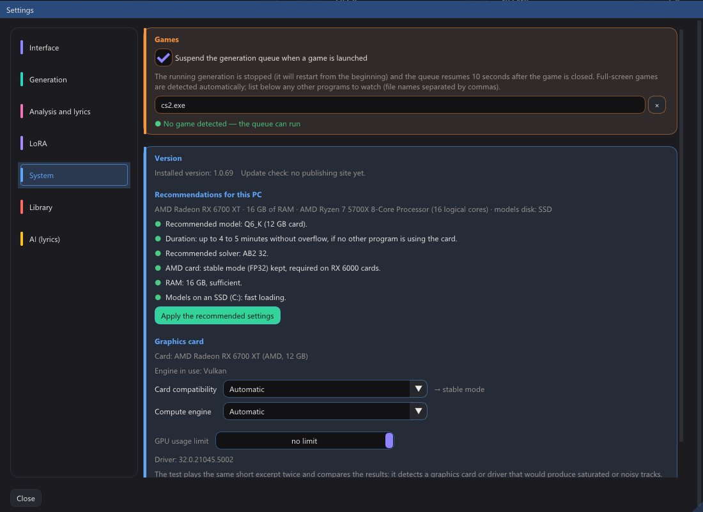
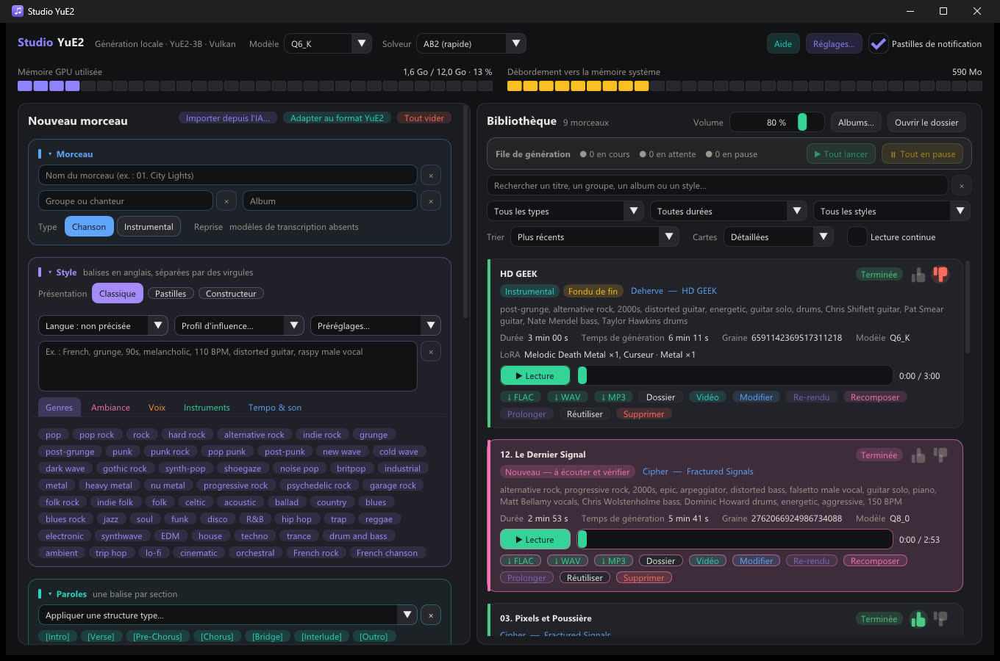
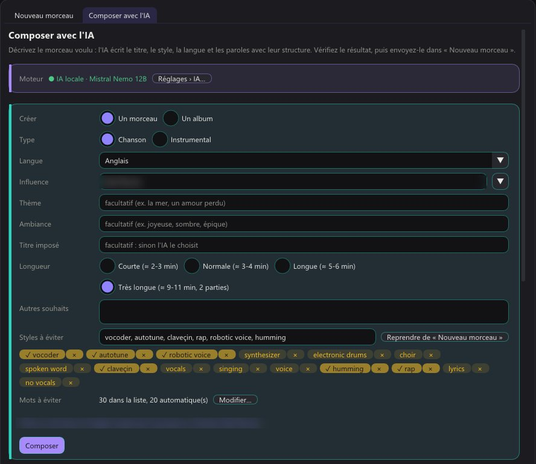
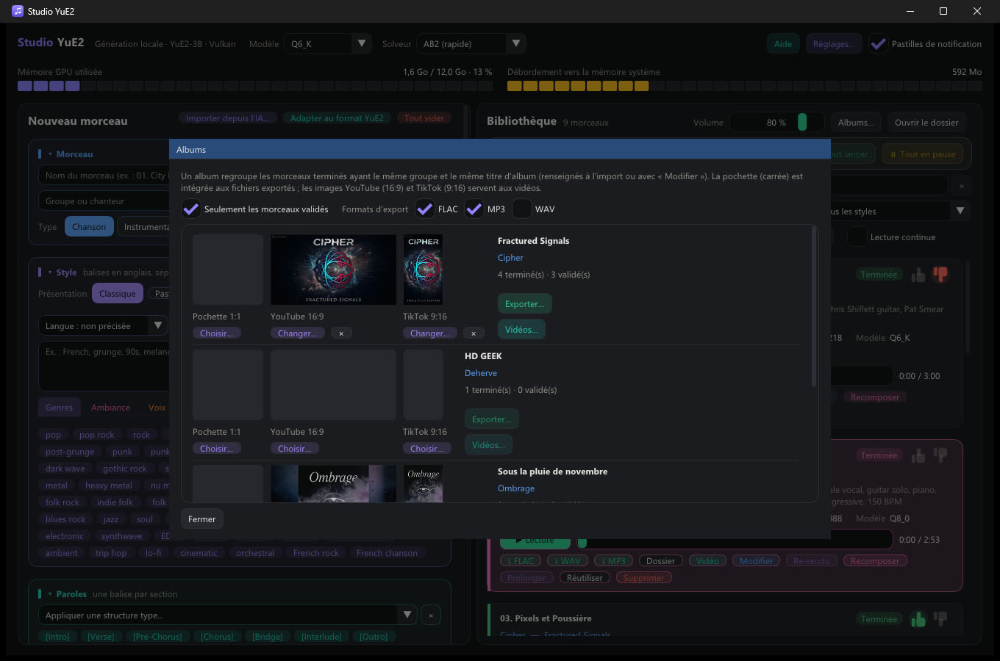
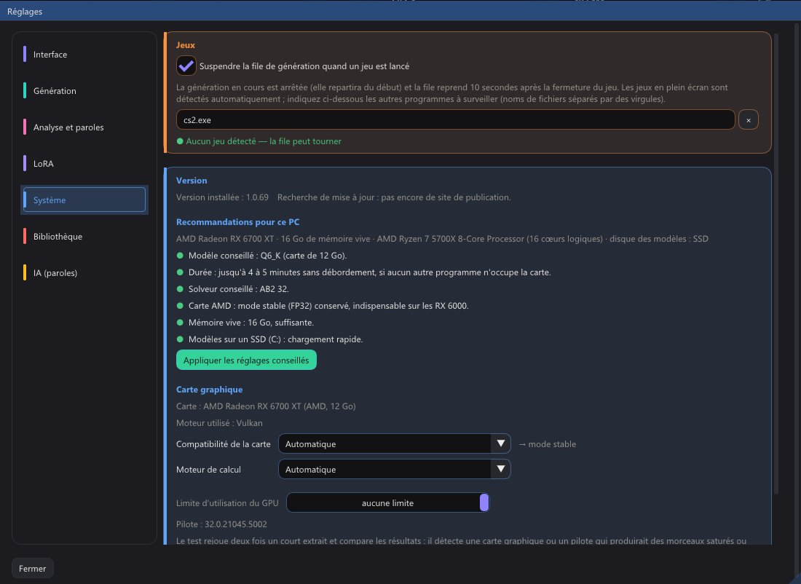

# Studio Audio AI

**[English](#english) · [Français](#français)**

---

## English

**Studio Audio AI** is a native Windows application that composes complete songs **locally**, on your own graphics card, with the **YuE2-3B** music model. It writes lyrics, generates vocals and instruments, organises your tracks into bands and albums, draws the covers and makes animated music videos with synchronised lyrics. Nothing is sent to a server: models, tracks and settings all stay in the program folder.

### Features

**Music generation**
- Songs (with vocals) or instrumentals, up to about 10 minutes (long tracks are generated in 2 or 3 parts and joined automatically).
- Style built from about 335 tags (genres, mood, voice, instruments, sound, tempo), or free text; 10 lyric languages.
- "Style to avoid" (negative tags), style presets, personal song structures, shareable `.yue2pack` style packs.
- LoRA support: a catalogue of 40 downloadable LoRA, plus your own (trigger words added automatically).
- Covers: re-sing an existing audio file in another style; analysis of a track (genres, tempo, key, lyrics with Whisper, online lyrics lookup).
- Generation queue with pause, several versions, fixed or random seed, choice of quantisation (Q8_0, Q6_K, Q5_K_M) and solver (speed / precision).

**Compose with AI**
- An AI writes a whole track (title, style, lyrics) or a **whole album of 1 to 50 tracks** in one go, from a theme, a mood and an influence.
- Built-in local AI (llama.cpp on the graphics card, model downloaded on demand), a local server (Ollama, LM Studio…) or an online service with your own API key.
- Varied lyrics: words to avoid, repeated lines removed, phrases already used in the album avoided; complete an existing album or continue an existing band.

**Albums, covers and videos**
- Library organised as `Audios\<Band>\<Album>\<NN. Title>\`, with filters, sorting, 4 card layouts, approved / to-check marks.
- Covers drawn locally (FLUX.2 klein, Z-Image Turbo, SDXL-Lightning, MOSS) or by an online service, in 1:1, 16:9 and 9:16.
- Export of an album to FLAC / MP3 / WAV with embedded cover.
- Videos for YouTube (16:9), TikTok (9:16) and Instagram (1:1): still image, or **animated clip** with lyrics synchronised by Whisper and one image per scene written by the local AI from the lyrics.
- **Shorts** (9:16, 15 to 90 s) centred on the chorus, one at a time or in series for an album or the whole library.
- AI-written descriptions of the band, the album and each track.

**Reliability**
- Quality check without listening: length, sung lyrics, abnormal silences, long-track part too short; tracks to redo get a red thumb.
- Daily automatic backup of settings, styles, LoRA list and track sheets; missing models reported at startup.
- Video memory check before each generation, GPU usage limit, CPU / GPU / memory gauges.
- Update notice when a new release is published on GitHub.
- Interface in 10 languages (English, French, Spanish, Italian, German, Portuguese, Japanese, Korean, Mandarin, Cantonese) and 4 themes.

### Screenshots

| | |
|---|---|
|  |  |
|  |  |

### Requirements

- Windows 10 or 11, 64-bit.
- A **Vulkan** graphics card (AMD, Nvidia or Intel) with plenty of video memory. Developed and tested on an **AMD Radeon RX 6700 XT 12 GB**; Nvidia cards are supported but untested (optional CUDA engine).
- 16 GB of RAM recommended.
- Disk space: about 5 GB for the music models, more for the optional AI, image and transcription models.

### Installation

1. Download `StudioAudioAI-<version>.zip` from the [Releases](https://github.com/deherve/Studio-Audio-AI/releases/latest) page.
2. Unzip it wherever you like: the folder is self-contained (models, library and settings stay inside) and can be copied to another drive or PC.
3. Run **Studio Audio AI.exe**. On first launch, it offers to download the YuE2-3B models from Hugging Face (about 4.6 GB) into the `modeles\` folder, or to let you copy model files you already have.
4. Optional models (local AI, covers, lyrics transcription, LoRA) are downloaded on demand from the Settings.

The full user guide is built into the application (**Help** button or **F1**).

### Building from source

This repository contains **only the sources**. Models, tracks, settings, API keys, executables, ffmpeg and demo audio are not included. To build:

- `_developpement/yue2.cpp`: <https://github.com/ServeurpersoCom/yue2.cpp>, with the patches in `_developpement/patches`;
- `_developpement/whisper.cpp`: <https://github.com/ggml-org/whisper.cpp>;
- `_developpement/native/third_party/ffmpeg_essentials`: ffmpeg for Windows (only needed for the distribution zip);
- Visual Studio 2022 (C++20), CMake, Vulkan SDK.

Then run `_developpement/build_studio_natif.cmd`, and `_developpement/native/make_distribution.ps1` to make the zips. Technical details: [_developpement/README.md](_developpement/README.md).

Built with C++20, Win32, DirectX 11 and [Dear ImGui](https://github.com/ocornut/imgui).

### Licences and usage

> **Non-commercial use.** The **YuE2** music models are released under **CC BY-NC 4.0** and the **Essentia** audio-analysis models under **CC BY-NC-SA 4.0**. Selling the tracks, covers and videos made with Studio Audio AI is subject to the licences of the models used: refer to the table below (also shown in Settings › System).

| Component | Licence |
|---|---|
| YuE2-3B models (music) | CC BY-NC 4.0 (non-commercial) |
| Essentia models (audio analysis) | CC BY-NC-SA 4.0 (non-commercial) |
| MERT-v2, SheetSage2 (covers, scores) | CC BY-NC 4.0 (non-commercial) |
| LoRA from the catalogue | each LoRA has its own licence, often non-commercial |
| Whisper models and whisper.cpp | MIT |
| llama.cpp, stable-diffusion.cpp, ggml, ONNX Runtime | MIT |
| Qwen 3, Qwen 2.5 7B/14B, Mistral Nemo/Small (text AI) | Apache 2.0 |
| Qwen 2.5 3B (text AI) | Qwen Research (non-commercial) |
| Llama 3.1, Gemma 2/3 (text AI) | Llama 3.1 Community License, Gemma Terms of Use |
| SDXL-Lightning (covers) | CreativeML OpenRAIL++-M |
| FLUX.2 klein 4B, Z-Image Turbo, MOSS-Image (covers) | Apache 2.0 |
| ffmpeg (distribution build) | GPL v3 |

The component licences shipped with the program are in the `LICENSES` folder of the zip. No licence has yet been chosen for the source code of Studio Audio AI itself: until a `LICENSE` file is added, all rights are reserved.

Models are downloaded from their official Hugging Face pages; check each model's licence before any public or commercial use of your creations.

---

## Français

**Studio Audio AI** est une application Windows native qui compose des chansons complètes **en local**, sur votre propre carte graphique, avec le modèle musical **YuE2-3B**. Elle écrit les paroles, génère la voix et les instruments, range vos morceaux par groupes et par albums, dessine les pochettes et fabrique des clips animés avec les paroles synchronisées. Rien n'est envoyé à un serveur : modèles, morceaux et réglages restent dans le dossier du programme.

### Fonctions

**Génération de musique**
- Chansons (avec voix) ou instrumentaux, jusqu'à environ 10 minutes (les morceaux longs sont générés en 2 ou 3 parties puis assemblés automatiquement).
- Style composé à partir d'environ 335 balises (genres, ambiance, voix, instruments, son, tempo), ou en texte libre ; paroles en 10 langues.
- « Style à éviter » (balises négatives), préréglages de style, structures personnelles, packs de styles `.yue2pack` à partager.
- LoRA : catalogue de 40 LoRA téléchargeables, plus les vôtres (mot déclencheur ajouté automatiquement).
- Reprises : rechanter un fichier audio existant dans un autre style ; analyse d'un morceau (genres, tempo, tonalité, paroles avec Whisper, recherche des paroles sur Internet).
- File de génération avec pause, plusieurs versions, graine fixe ou aléatoire, choix de la quantification (Q8_0, Q6_K, Q5_K_M) et du solveur (vitesse / précision).

**Composer avec l'IA**
- Une IA écrit un morceau complet (titre, style, paroles) ou **un album entier de 1 à 50 morceaux** d'un coup, d'après un thème, une ambiance et une influence.
- IA locale intégrée (llama.cpp sur la carte graphique, modèle téléchargé à la demande), serveur local (Ollama, LM Studio…) ou service en ligne avec votre propre clé d'API.
- Paroles variées : mots à éviter, lignes recopiées retirées, phrases déjà utilisées dans l'album évitées ; compléter un album existant ou poursuivre un groupe existant.

**Albums, pochettes et vidéos**
- Bibliothèque rangée en `Audios\<Groupe>\<Album>\<NN. Titre>\`, avec filtres, tris, 4 présentations de cartes, marques « validé » / « à problème ».
- Pochettes dessinées en local (FLUX.2 klein, Z-Image Turbo, SDXL-Lightning, MOSS) ou par un service en ligne, en 1:1, 16:9 et 9:16.
- Export d'un album en FLAC / MP3 / WAV avec la pochette intégrée.
- Vidéos pour YouTube (16:9), TikTok (9:16) et Instagram (1:1) : image fixe, ou **clip animé** avec les paroles synchronisées par Whisper et une image par scène, écrite par l'IA locale d'après les paroles.
- **Shorts** (9:16, 15 à 90 s) centrés sur le refrain, un par un ou en série pour un album ou toute la bibliothèque.
- Descriptions du groupe, de l'album et de chaque morceau rédigées par l'IA.

**Fiabilité**
- Contrôle qualité sans réécoute : durée, paroles chantées, silences anormaux, partie de morceau long trop courte ; les morceaux à refaire reçoivent un pouce rouge.
- Sauvegarde automatique quotidienne des réglages, styles, liste des LoRA et fiches des morceaux ; modèles manquants signalés au démarrage.
- Vérification de la mémoire vidéo avant chaque génération, limite d'utilisation de la carte, compteurs processeur / carte / mémoire.
- Pastille « Mettre à jour » dès qu'une nouvelle version est publiée sur GitHub.
- Interface en 10 langues (français, anglais, espagnol, italien, allemand, portugais, japonais, coréen, mandarin, cantonais) et 4 thèmes.

### Captures

| | |
|---|---|
|  |  |
|  |  |

### Configuration requise

- Windows 10 ou 11, 64 bits.
- Une carte graphique compatible **Vulkan** (AMD, Nvidia ou Intel) avec beaucoup de mémoire vidéo. Développé et testé sur une **AMD Radeon RX 6700 XT 12 Go** ; les cartes Nvidia sont prises en charge mais non testées (moteur CUDA facultatif).
- 16 Go de mémoire vive conseillés.
- Espace disque : environ 5 Go pour les modèles de musique, davantage pour les modèles facultatifs (IA, images, transcription).

### Installation

1. Téléchargez `StudioAudioAI-<version>.zip` sur la page [Releases](https://github.com/deherve/Studio-Audio-AI/releases/latest).
2. Décompressez-le où vous voulez : le dossier est autonome (modèles, bibliothèque et réglages restent dedans) et peut être copié sur un autre disque ou un autre PC.
3. Lancez **Studio Audio AI.exe**. Au premier lancement, il propose de télécharger les modèles YuE2-3B depuis Hugging Face (environ 4,6 Go) dans le dossier `modeles\`, ou de copier vous-même des modèles déjà présents sur votre PC.
4. Les modèles facultatifs (IA locale, pochettes, transcription des paroles, LoRA) se téléchargent à la demande depuis les Réglages.

Le guide complet est intégré à l'application (bouton **Aide** ou touche **F1**).

### Compiler depuis les sources

Ce dépôt ne contient **que les sources**. Modèles, morceaux, réglages, clés d'API, exécutables, ffmpeg et démos audio n'y sont pas. Pour compiler, il faut aussi :

- `_developpement/yue2.cpp` : <https://github.com/ServeurpersoCom/yue2.cpp>, avec les correctifs de `_developpement/patches` ;
- `_developpement/whisper.cpp` : <https://github.com/ggml-org/whisper.cpp> ;
- `_developpement/native/third_party/ffmpeg_essentials` : ffmpeg pour Windows (seulement pour fabriquer le zip) ;
- Visual Studio 2022 (C++20), CMake, le SDK Vulkan.

Puis lancer `_developpement/build_studio_natif.cmd`, et `_developpement/native/make_distribution.ps1` pour les zips. Détails techniques : [_developpement/README.md](_developpement/README.md).

Écrit en C++20, Win32, DirectX 11 et [Dear ImGui](https://github.com/ocornut/imgui).

### Licences et usage

> **Usage non commercial.** Les modèles musicaux **YuE2** sont publiés sous licence **CC BY-NC 4.0** et les modèles d'analyse audio **Essentia** sous **CC BY-NC-SA 4.0**. La commercialisation des morceaux, pochettes et vidéos créés avec Studio Audio AI est soumise aux licences des modèles utilisés : référez-vous au tableau ci-dessous (aussi affiché dans Réglages › Système).

| Composant | Licence |
|---|---|
| Modèles YuE2-3B (musique) | CC BY-NC 4.0 (non commercial) |
| Modèles Essentia (analyse audio) | CC BY-NC-SA 4.0 (non commercial) |
| MERT-v2, SheetSage2 (reprises, partitions) | CC BY-NC 4.0 (non commercial) |
| LoRA du catalogue | chaque LoRA a sa licence, souvent non commerciale |
| Modèles Whisper et whisper.cpp | MIT |
| llama.cpp, stable-diffusion.cpp, ggml, ONNX Runtime | MIT |
| Qwen 3, Qwen 2.5 7B/14B, Mistral Nemo/Small (IA de texte) | Apache 2.0 |
| Qwen 2.5 3B (IA de texte) | Qwen Research (non commercial) |
| Llama 3.1, Gemma 2/3 (IA de texte) | Llama 3.1 Community License, Gemma Terms of Use |
| SDXL-Lightning (pochettes) | CreativeML OpenRAIL++-M |
| FLUX.2 klein 4B, Z-Image Turbo, MOSS-Image (pochettes) | Apache 2.0 |
| ffmpeg (version livrée) | GPL v3 |

Les licences des composants livrés sont dans le dossier `LICENSES` du zip. Aucune licence n'a encore été choisie pour le code source de Studio Audio AI lui-même : tant qu'aucun fichier `LICENSE` n'est ajouté, tous droits réservés.

Les modèles sont téléchargés depuis leurs pages officielles sur Hugging Face ; vérifiez la licence de chaque modèle avant toute utilisation publique ou commerciale de vos créations.
